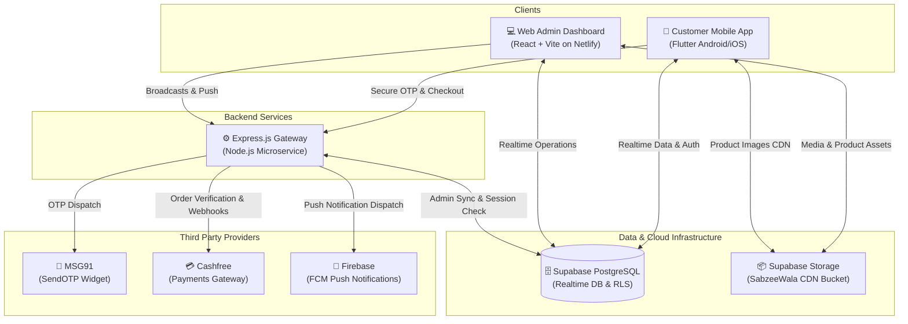

<div align="center">

# 🥬 SabzeeWala

**Next-Gen Hyperlocal Quick-Commerce & Fresh Produce Delivery Platform**

[](https://flutter.dev)
[](https://react.dev)
[](https://vitejs.dev)
[](https://nodejs.org)
[](https://expressjs.com)
[](https://supabase.com)
[](https://sabzeeewala.netlify.app/)
[]()

[📱 Mobile App](#-customer-mobile-experience-flutter) • [💻 Web Admin](#-operations--inventory-management-web-admin) • [⚙️ Backend API](#-backend-gateway-nodejs-express) • [🚀 Quick Start](#-getting-started) • [🚢 Deployment](#-production-deployment)

</div>

---

## 🌟 Overview

**SabzeeWala** is an end-to-end, production-ready quick commerce ecosystem engineered for farm-to-door fresh vegetable and grocery delivery in 10-15 minutes. Built with high concurrency, real-time sync, and enterprise reliability in mind.

### 🌐 Live Deployments

| Component | Status | URL / Destination |
|---|---|---|
| **Web Admin Operations** | 🟢 Live | [https://sabzeeewala.netlify.app/](https://sabzeeewala.netlify.app/) |
| **Backend REST Service** | 🚀 Cloud-Ready | Render / Railway / Container (`backend/`) |
| **Mobile Client** | 📱 Production-Ready | Android APK / App Bundle & iOS Runner |
| **Cloud Database & CDN** | ⚡ Active | Supabase PostgreSQL (`SabzeeWala` Storage) |

---

## 🏗️ System Architecture



---

## 📦 Monorepo Structure

```
├── lib/                        # 📱 Flutter Mobile Application
│   ├── constants/              # App themes, colors, and environment loaders
│   ├── models/                 # Dart domain models (Product, Order, Address, Outlet, etc.)
│   ├── providers/              # State management via ChangeNotifier (AppState)
│   ├── screens/                # User journey screens (Home, Catalog, Checkout, Tracking, etc.)
│   ├── services/               # Device fingerprinting, Cashfree, Supabase, and Notifications
│   └── widgets/                # Modular UI components (Invoice sheet, Quantities, Banners)
│
├── backend/                    # ⚙️ Node.js Express Backend Microservice
│   ├── server.js               # REST API, MSG91 OTP widget, Cashfree webhooks & FCM service
│   ├── package.json            # Dependencies & start scripts
│   ├── .env.example            # Backend environment schema template
│   └── README.md               # Backend deployment instructions (Render / Railway)
│
├── web_admin/                  # 💻 React + Vite Admin Control Panel
│   ├── src/                    # Pages (Dashboard, Inventory, Orders, Outlets, Reports, etc.)
│   ├── netlify.toml            # Netlify build and redirect configurations
│   ├── public/                 # Static assets, branding, and icons
│   └── package.json            # Web admin dependencies and build pipeline
│
├── .env.example                # Root environment template
└── supabase_master_schema.sql  # Complete database schema, RLS policies, tables & triggers
```

---

## ✨ Key Capabilities

### 📱 1. Customer Mobile Experience (Flutter)
- **Instant OTP Login:** MSG91 SendOTP widget with graceful session resume & offline fallback.
- **Silent Anti-Fraud Device Registry:** Hardware fingerprinting (`brand`, `model`, `hardware ID`, `screen resolution`, `network type`) stored silently in Supabase DB for fraud prevention without UI clutter.
- **Smart User Onboarding:** Automatically identifies new vs existing users, loading previous addresses & wishlist immediately, or directing new users to profile completion.
- **Dynamic Wallet & Credits:** In-app digital wallet supporting cash additions, referral bonuses, and one-tap checkout deductions.
- **Live Order Timeline:** Real-time order tracking (`Confirmed` ➔ `Packing` ➔ `Out for Delivery` ➔ `Delivered`) backed by Supabase WebSocket subscriptions.
- **Flexible Payments:** Cashfree Payment Gateway (UPI, Cards, NetBanking), Cash on Delivery (COD), and Wallet balance splits.

### 💻 2. Operations & Inventory Management (Web Admin)
- **Multi-Outlet Inventory Control:** Live stock adjustments, low-stock warnings, and outlet-specific availability.
- **Real-Time Order Dispatch:** Instant alerts on new orders, live delivery partner assignment, and printable invoices.
- **Rich Catalog Engine:** Manage categories, sub-categories, multi-size variants (e.g. 250g, 500g, 1kg), discounts, and CDN image uploads.
- **Customer 360 & Analytics:** Lifetime order values, active sessions, customer support resolution, and CSV financial exports.

### ⚙️ 3. Backend Gateway (Node.js Express)
- **Secure Webhooks:** Cashfree payment webhook verification to automatically credit customer wallets and mark orders as paid.
- **Push Notification Engine:** Firebase Cloud Messaging (FCM) broadcast APIs for order status changes and promotional banners.
- **Safe Secrets Handling:** Zero-leak design separating credentials via system environment variables.

---

## 🚀 Getting Started

### Prerequisites
- [Flutter SDK](https://flutter.dev/docs/get-started/install) (3.24+ recommended)
- [Node.js](https://nodejs.org/) (v18 or higher)
- [Git](https://git-scm.com/)

---

### 1️⃣ Setting Up Mobile App
```bash
# Clone the repository
git clone https://github.com/SabzeeWala-Business/SabzeeWala.git
cd SabzeeWala

# Setup environment
cp .env.example .env
# (Fill your Supabase, MSG91, and Cashfree credentials in .env)

# Install Flutter dependencies
flutter pub get

# Run on connected physical device or emulator
flutter run --dart-define-from-file=.env
```

---

### 2️⃣ Setting Up Backend Service
```bash
cd backend
npm install

# Setup environment
cp .env.example .env
# (Configure your JWT_SECRET, SUPABASE_ANON_KEY, and Cashfree keys)

# Run development server
npm run dev
# Starts on http://localhost:5000
```

---

### 3️⃣ Setting Up Web Admin Dashboard
```bash
cd web_admin
npm install

# Setup environment
cp .env.example .env

# Run local dashboard
npm run dev
# Opens at http://localhost:5173
```

---

## 🚢 Production Deployment

### 🌐 Deploying Web Admin to Netlify
1. Connect this GitHub repository on [Netlify](https://app.netlify.com).
2. Set **Base directory** to `web_admin`.
3. Set **Build command** to `npm run build` and **Publish directory** to `web_admin/dist`.
4. Configure environment variables in Netlify UI:
   - `VITE_SUPABASE_URL`
   - `VITE_SUPABASE_ANON_KEY`
   - `VITE_API_URL`

### ⚙️ Deploying Backend to Render / Railway
1. Create a **New Web Service** on [Render](https://render.com).
2. Point to this repository and set **Root Directory** to `backend`.
3. Set **Start Command** to `node server.js`.
4. Add all environment variables listed in `backend/.env.example`.
5. Your service will be assigned an HTTPS endpoint (e.g., `https://sabzee-backend.onrender.com`).

---

## 🔒 Security & Data Privacy

- **No Hardcoded Secrets:** All API keys, tokens, and database passwords are kept outside version control and injected via `.env` files or secure runtime secrets.
- **Row-Level Security (RLS):** Supabase database uses strict RLS policies to isolate customer orders, personal details, and wallet transactions.
- **Anti-Tampering Device Checks:** Hardware metadata is logged for authentication validation without accessing or exposing user contacts or private storage.

---

<div align="center">

**SabzeeWala** — *Fresh vegetables. Honest prices. Ultra-fast delivery.* 🥦🍅🚀

</div>
