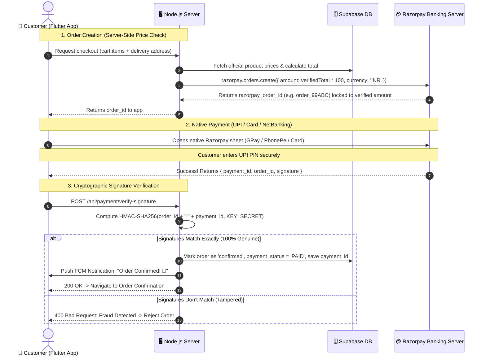

# SabzeeWala — Secure Payment Gateway Integration Guide (Razorpay)

This document is divided into two parts:
1. **PART A: Client / Business Owner Action Guide** *(You can copy and send this directly to your client)*
2. **PART B: Developer Technical & Security Blueprint** *(How the payment flow is protected against fraud and amount leakage)*

---

# PART A: Client Handover Guide (Send This to Your Client)

> **Dear Client / Store Owner:**  
> To accept UPI (Google Pay, PhonePe, Paytm, BHIM), Debit/Credit Cards, and Net Banking directly into your company bank account, we use **Razorpay** — India’s leading and most trusted payment gateway.  
> Please follow the 4 quick steps below to set up your business account and provide the API credentials.

---

### Step 1: Create Your Razorpay Account
1. Visit the official registration portal: **[https://easy.razorpay.com/onboarding](https://easy.razorpay.com/onboarding)** (or [https://razorpay.com](https://razorpay.com)).
2. Sign up using your official business email address and mobile number.
3. Choose your business type:
   - **Proprietorship / Individual** (if running under your own name or sole trade)
   - **Partnership / LLP / Private Limited** (if registered registered entity)

---

### Step 2: Complete KYC Verification
To allow real money to be deposited directly into your bank account, government regulations (RBI) require a standard KYC. You will need:

| Document / Detail | What to Keep Ready |
| :--- | :--- |
| **Business PAN Card** | Personal PAN (for Individual/Proprietor) OR Company PAN |
| **Identity & Address Proof** | Aadhaar Card / Passport / Voter ID |
| **Bank Account for Settlements** | Cancelled cheque or bank statement showing Account Number & IFSC code (where daily customer payments will be deposited) |
| **Business Registration** *(optional for small sellers)* | GSTIN certificate, Udyam / MSME certificate, or local Shop & Establishment license |
| **Website / App Details** | Provide your App Name: **SabzeeWala** and business description: *Online Fresh Vegetables & Groceries Quick Delivery* |

*Approval typically takes 24 to 48 business hours after document submission.*

---

### Step 3: Generate the API Keys
Once your account is created, you can generate the keys immediately:

#### 1. For Testing (Available Instantly, No KYC Needed):
1. In the top-right corner of the Razorpay Dashboard, ensure the toggle is set to **Test Mode**.
2. In the left menu, go to: **Account & Settings** $\rightarrow$ **API Keys** (under *Developer Controls*).
3. Click **Generate Key**.
4. You will see:
   - `Key ID` (starts with `rzp_test_...`)
   - `Key Secret` (a string of letters and numbers)
5. Download or copy both keys.

#### 2. For Production / Live Money (After KYC Approval):
1. Toggle the switch at top-right to **Live Mode**.
2. Go to: **Account & Settings** $\rightarrow$ **API Keys**.
3. Click **Generate Live Key**.
4. You will get:
   - `Live Key ID` (starts with `rzp_live_...`)
   - `Live Key Secret`

---

### Step 4: What You Need to Send Your Developer

Please send the developer the following items securely:

```text
=====================================================
SABZEEWALA PAYMENT CREDENTIALS HANDOVER
=====================================================
MODE: [Test / Live]

1. Razorpay Key ID:     rzp_test_xxxxxxxxxxxxxx  (or rzp_live_...)
2. Razorpay Key Secret: xxxxxxxxxxxxxxxxxxxxxxxx

Settlement Bank Account: [Bank Name] [Last 4 digits: ****1234]
=====================================================
```

> **Security Note:** Never post your `Key Secret` in public chat groups. Send it directly and privately to your developer.

---

# PART B: Developer Technical & Security Blueprint

---

## 1. Zero Amount Leakage & Anti-Fraud Architecture

In e-commerce apps, fraud happens when developers trust the mobile app to report how much was paid. In SabzeeWala, the security architecture follows the **Server-Side Price Locking & Signature Verification Standard**:



### The 4 Security Rules Enforced:
1. **Server-Side Price Locking:** The customer cannot modify the price. Even if they decompile the Flutter APK and change the cart to ₹1, Razorpay’s server will reject the payment because the `order_id` was permanently locked to the true cart price on the backend.
2. **HMAC-SHA256 Cryptographic Signature:** Razorpay signs the receipt using your private `RAZORPAY_KEY_SECRET`. The backend recalculates the mathematical hash. It is mathematically impossible to counterfeit this signature without the secret key.
3. **Replay Protection (Unique Payment ID):** Each `payment_id` can only be used once. Supabase enforces `UNIQUE(payment_id)`.
4. **Server Webhooks (Network Failure Insurance):** If a customer pays but their phone battery dies before returning to the app, Razorpay’s banking server directly calls your backend webhook to confirm the order.

---

## 2. Test Mode vs Live Production Comparison

| Feature | Test / Sandbox Mode | Production / Live Mode |
| :--- | :--- | :--- |
| **API Key Prefix** | Starts with `rzp_test_...` | Starts with `rzp_live_...` |
| **Real Money Charged?** | **No.** Completely fake simulated money. | **Yes.** Real money debited from customer bank. |
| **How to Test UPI** | Enter any UPI ID like `success@razorpay` | Real UPI apps (Google Pay, PhonePe, Paytm, CRED) |
| **How to Test Cards** | Use Razorpay Test Card numbers (e.g. `4111 1111 1111 1111`) | Real customer Visa/Mastercard/RuPay cards |
| **Settlement Time** | None | Deposited to client bank account in **T+1 or T+2 days** |
| **Transaction Fee** | ₹0 | Standard 2% + 18% GST (standard RBI gateway rate) |

---

## 3. Database Schema for Supabase

Run this in your **Supabase SQL Editor** to store verified payment audit logs:

```sql
-- Add payment verification columns to orders table
ALTER TABLE public.orders 
  ADD COLUMN IF NOT EXISTS payment_id text UNIQUE,
  ADD COLUMN IF NOT EXISTS payment_order_id text,
  ADD COLUMN IF NOT EXISTS payment_signature text,
  ADD COLUMN IF NOT EXISTS payment_status text DEFAULT 'PENDING'; -- PENDING | PAID | FAILED | REFUNDED

-- Index for instant lookup & fraud prevention
CREATE INDEX IF NOT EXISTS idx_orders_payment_id ON public.orders(payment_id);
```

---

## 4. Backend Implementation ([backend/server.js](file:///c:/Sabzee/subzee/backend/server.js))

### Dependencies:
```bash
cd backend
npm install razorpay crypto
```

### Configuration ([backend/.env](file:///c:/Sabzee/subzee/backend/.env)):
```env
RAZORPAY_KEY_ID=rzp_test_YOUR_KEY_ID_HERE
RAZORPAY_KEY_SECRET=YOUR_KEY_SECRET_HERE
```

### Endpoints in `server.js`:
```javascript
const Razorpay = require('razorpay');
const crypto = require('crypto');

const razorpay = new Razorpay({
  key_id: process.env.RAZORPAY_KEY_ID,
  key_secret: process.env.RAZORPAY_KEY_SECRET,
});

// 1. Create Order (Server-Side Price Calculation)
app.post('/api/payment/create-order', async (req, res) => {
  const { amount, receipt, userId } = req.body;

  if (!amount || Number(amount) <= 0) {
    return res.status(400).json({ error: 'Valid amount is required.' });
  }

  try {
    const options = {
      amount: Math.round(Number(amount) * 100), // Convert Rupees to Paise
      currency: 'INR',
      receipt: receipt || `rcpt_${Date.now()}`,
      notes: {
        userId: userId || 'guest',
        appName: 'SabzeeWala',
      },
    };

    const order = await razorpay.orders.create(options);
    return res.json({ success: true, order });
  } catch (err) {
    console.error('[Razorpay Create Order Error]:', err);
    return res.status(500).json({ error: err.message || 'Failed to initialize payment.' });
  }
});

// 2. Cryptographic Signature Verification & Order Confirmation
app.post('/api/payment/verify-signature', async (req, res) => {
  const { razorpay_order_id, razorpay_payment_id, razorpay_signature, orderId, userId } = req.body;
  const key_secret = process.env.RAZORPAY_KEY_SECRET;

  if (!razorpay_order_id || !razorpay_payment_id || !razorpay_signature) {
    return res.status(400).json({ error: 'Missing payment proof parameters.' });
  }

  // Generate cryptographic hash
  const generated_signature = crypto
    .createHmac('sha256', key_secret)
    .update(`${razorpay_order_id}|${razorpay_payment_id}`)
    .digest('hex');

  // Verify signature match
  if (generated_signature !== razorpay_signature) {
    console.warn(`[SECURITY ALERT] Payment signature mismatch for Order ${orderId}! Fraud attempt blocked.`);
    return res.status(400).json({ success: false, message: 'Invalid payment signature. Verification failed.' });
  }

  // 100% Genuine Payment Verified! Update database:
  try {
    if (orderId) {
      await supabase
        .from('orders')
        .update({
          payment_id: razorpay_payment_id,
          payment_order_id: razorpay_order_id,
          payment_signature: razorpay_signature,
          payment_status: 'PAID',
          order_status: 'confirmed',
        })
        .eq('id', orderId);
    }

    return res.json({
      success: true,
      verified: true,
      paymentId: razorpay_payment_id,
    });
  } catch (dbErr) {
    console.error('Database update error after payment verification:', dbErr);
    return res.status(500).json({ error: 'Payment verified, but failed to update order record.' });
  }
});

// 3. Webhook (Fallback for Disconnected Customers)
app.post('/api/payment/webhook', async (req, res) => {
  const webhookSecret = process.env.RAZORPAY_WEBHOOK_SECRET || 'sabzee_webhook_secret';
  const signature = req.headers['x-razorpay-signature'];

  const expectedSignature = crypto
    .createHmac('sha256', webhookSecret)
    .update(JSON.stringify(req.body))
    .digest('hex');

  if (expectedSignature !== signature) {
    return res.status(400).send('Invalid webhook signature');
  }

  const event = req.body.event;
  if (event === 'payment.captured') {
    const payment = req.body.payload.payment.entity;
    console.log(`[Webhook Confirmed] Payment captured: ${payment.id} for ₹${payment.amount / 100}`);
  }

  res.json({ status: 'ok' });
});
```

---

## 5. Mobile App Implementation ([lib/screens/checkout_screen.dart](file:///c:/Sabzee/subzee/lib/screens/checkout_screen.dart))

### Add Dependency:
```yaml
dependencies:
  razorpay_flutter: ^1.3.7
```

### Checkout Screen Logic:
```dart
import 'package:razorpay_flutter/razorpay_flutter.dart';
import 'package:http/http.dart' as http;
import 'dart:convert';

class _CheckoutScreenState extends State<CheckoutScreen> {
  late Razorpay _razorpay;

  @override
  void initState() {
    super.initState();
    _razorpay = Razorpay();
    _razorpay.on(Razorpay.EVENT_PAYMENT_SUCCESS, _handlePaymentSuccess);
    _razorpay.on(Razorpay.EVENT_PAYMENT_ERROR, _handlePaymentError);
    _razorpay.on(Razorpay.EVENT_EXTERNAL_WALLET, _handleExternalWallet);
  }

  @override
  void dispose() {
    _razorpay.clear();
    super.dispose();
  }

  // 1. Initialize Order with Backend
  Future<void> startOnlinePayment(double totalAmount) async {
    try {
      final response = await http.post(
        Uri.parse('https://YOUR_BACKEND_URL/api/payment/create-order'),
        headers: {'Content-Type': 'application/json'},
        body: jsonEncode({
          'amount': totalAmount,
          'userId': Provider.of<AppState>(context, listen: false).userMobile,
        }),
      );

      final data = jsonDecode(response.body);
      if (data['success'] == true) {
        final String orderId = data['order']['id'];
        _openCheckout(totalAmount, orderId);
      } else {
        ScaffoldMessenger.of(context).showSnackBar(
          SnackBar(content: Text(data['error'] ?? 'Could not initialize payment.')),
        );
      }
    } catch (e) {
      debugPrint('Payment Init Error: $e');
    }
  }

  // 2. Open Razorpay Checkout Sheet
  void _openCheckout(double totalAmount, String razorpayOrderId) {
    final appState = Provider.of<AppState>(context, listen: false);

    var options = {
      'key': 'rzp_test_YOUR_KEY_ID', // Replace with client key
      'amount': (totalAmount * 100).toInt(),
      'name': 'SabzeeWala',
      'order_id': razorpayOrderId,
      'description': 'Fresh Groceries Order',
      'prefill': {
        'contact': appState.userMobile ?? '9876543210',
        'email': appState.userEmail ?? 'customer@sabzeewala.com',
      },
      'theme': {'color': '#1B5E20'}, // SabzeeWala Forest Green
    };

    try {
      _razorpay.open(options);
    } catch (e) {
      debugPrint('Razorpay launch exception: $e');
    }
  }

  // 3. Cryptographic Verification Callback
  void _handlePaymentSuccess(PaymentSuccessResponse response) async {
    showDialog(
      context: context,
      barrierDismissible: false,
      builder: (_) => const Center(child: CircularProgressIndicator(color: Colors.green)),
    );

    final verifyRes = await http.post(
      Uri.parse('https://YOUR_BACKEND_URL/api/payment/verify-signature'),
      headers: {'Content-Type': 'application/json'},
      body: jsonEncode({
        'razorpay_order_id': response.orderId,
        'razorpay_payment_id': response.paymentId,
        'razorpay_signature': response.signature,
      }),
    );

    Navigator.pop(context); // Dismiss spinner

    final result = jsonDecode(verifyRes.body);
    if (result['verified'] == true) {
      final appState = Provider.of<AppState>(context, listen: false);
      appState.placeOrder('ONLINE', customAmount: finalPayTotal);
      Navigator.pushReplacement(
        context,
        MaterialPageRoute(builder: (_) => const OrderConfirmationScreen()),
      );
    } else {
      ScaffoldMessenger.of(context).showSnackBar(
        const SnackBar(
          content: Text("Payment security verification failed. Please contact support."),
          backgroundColor: Colors.red,
        ),
      );
    }
  }

  void _handlePaymentError(PaymentFailureResponse response) {
    ScaffoldMessenger.of(context).showSnackBar(
      SnackBar(
        content: Text("Payment Cancelled / Failed: ${response.message}"),
        backgroundColor: Colors.orange,
      ),
    );
  }

  void _handleExternalWallet(ExternalWalletResponse response) {
    debugPrint("External Wallet Selected: ${response.walletName}");
  }
}
```

---

## 6. How to Switch from Test Mode to Production Live Mode

When the client sends you their live credentials:

1. **In Backend (`.env`):**
   ```env
   RAZORPAY_KEY_ID=rzp_live_xxxxxxxxxxxxxx
   RAZORPAY_KEY_SECRET=LiveSecretYYYYYYYYYYYYYY
   ```
2. **In Flutter (`checkout_screen.dart`):**
   ```dart
   'key': 'rzp_live_xxxxxxxxxxxxxx', // Replace with Live Key ID
   ```
3. Restart backend server and rebuild Flutter app. Real money will be collected and deposited directly into the client's bank account.
